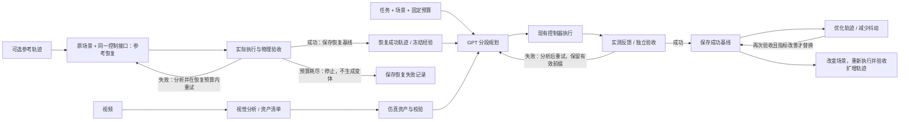

# CaP Sim

当前为开发中的研究版本。完整 G1 流程依赖外部机器人资产、模型权重和参考轨迹；部分脚本需按本机环境配置路径。

用 Code-as-Policy 生成、验证和扩增仿真轨迹。输入任务、可选参考轨迹／经验文档／视频，输出**经过物理验收的成功轨迹**，同时保留失败记录和可复用的动作前缀。

这是从 G1 单手抓苹果实验整理出的独立仓库。核心调度、CLI、轨迹格式和资产构建已独立；G1/SONIC 适配器仍读取外部实验运行时、机器人资产和模型权重。原实验与 `isaac-state-renderer` 不需要被修改。



便携 MuJoCo 双指夹爪示例和原 G1/Dex3/SONIC 适配器支持“接触抓取后抬升指定高度并保持指定时间”。原生 HUMANO 后端另支持其任务自身的验收，包括踢球、推物、坐椅、按按钮和抓取。新机器人可接后端；这里不承诺任意任务、任意视频都能自动求解。

## 两条研究路线

- [trajectory_retargeting](trajectory_retargeting/README.md)：原成功轨迹作骨架、调整动作的历史源码快照，含原位置和哈希；依赖原实验数据，尚未改造成独立入口。
- [skill_generation](skill_generation/README.md)：纯 skill 驱动生成的独立准备目录，包含经验草稿、输入边界与实验模板；尚未执行验证。

两条路线均保存在本仓库；原始实验、轨迹和视频保留在外部实验目录。

## 快速运行

每次新实验先填写并冻结[统一实验记录](docs/experiment-records.md)：目的、对照基线、逐阶段物理/控制接口、运行环境、pipeline与skill哈希、预算及误差定义。使用[JSON模板](docs/experiment-record.template.json)，记录实际执行模式；禁止未声明的IK/teleop接口切换。

后续HUMANO实验固定为TensorRT10.13.0.35＋ONNX Runtime1.23.2＋SONIC1.0 CPU，使用`./scripts/humano_python.sh`启动并校验版本与模型哈希。TensorRT作为环境依赖存在，SONIC三组模型仍明确走CPUExecutionProvider；本地包装包版本和模型版本分别记录。详见[运行环境](docs/runtime.md)。历史实验环境记录不回写。

Python 3.10+；仿真推荐独立环境。渲染及视频抽帧需要系统 `ffmpeg` / `ffprobe`，无头渲染需要可用 EGL。

```bash
python -m pip install -e '.[sim,test]'
cap-sim run --task examples/lift.json --planner demo \
  --no-reference --out runs/no_reference
cap-sim render-demo --attempt runs/no_reference/attempts/001 \
  --out runs/no_reference_video
```

`demo` 是确定性集成测试规划器，使用真实 MuJoCo 接触物理，**不是 GPT**。示例会先保存一次成功，再试一次减速优化；优化失败不影响先前成功。机器人是笛卡尔夹爪，不能把示例成功解释成 G1 成功。

输出中 `summary.json` 给出成功与选中的轨迹编号。`success/attempt_001/` 保存动作、逐步物理证据、状态数组和场景 XML；失败尝试保存在 `attempts/`。G1 场景仍引用外部机器人网格。

## 用 GPT 规划与诊断

```bash
export OPENAI_API_KEY='你的 API key'
cap-sim run --task examples/lift.json --planner openai \
  --model YOUR_MODEL --no-reference --out runs/gpt_no_reference
```

通过 [OpenAI Responses API](https://developers.openai.com/api/docs/guides/responses) 调用显式指定的模型。支持兼容服务的 `--base-url`。密钥只读环境变量，不写仓库。模型响应、用量和调用用时写入相邻的 `*_model_calls/`；测试使用模拟 HTTP 响应，尚未在本仓库验证在线 GPT 的任务成功率。

规划器输出有限 JSON 动作程序，控制器负责每帧运动。不是执行模型生成的任意 Python：

```json
{
  "analysis": {
    "evidence": ["上一阶段已建立持续双侧接触"],
    "hypothesis": "先小幅抬升，再判断是否保持接触",
    "change": "本段抬升 2 cm"
  },
  "actions": [
    {"stage":"lift","wrist_offset":[0,0,0.02],"duration_s":0.5,"replan_after":true}
  ]
}
```

示例只是已确认接触后的局部动作，不能直接当完整初始规划。动作可加 `replan_after`，阶段完成后将实测观测交给 GPT，替换尚未执行的后续动作。默认最多 8 次阶段反馈；每次尝试最多 200 个动作。`wrist_offset` 在执行时相对当前测得的手腕位置解析。失败反馈进入下一次规划，错误分析先写盘，再重置执行。

也支持 `--planner file --plans plans.json`（每次尝试一份程序）和 `--planner command --command '["python","my_planner.py"]'`（JSON stdin/stdout，自行配置的可信命令）。

## 有参考生成与冻结经验

支持导入本仓库成功包、旧 G1 实验目录及下载的 HUMANO parquet。HUMANO 原始轨迹通过兼容 G1 场景做正向运动学，输出物体相对手腕几何；缺失的原始接触点／力不会被当成真值。

```bash
cap-sim import-reference \
  --source runs/no_reference/success/attempt_001/trajectory.json \
  --out runs/reference.json
cap-sim summarize-reference --reference runs/reference.json \
  --planner openai --model YOUR_MODEL --out runs/experience
```

总结结果包含冻结的 `skill.json` 与可读 `skill.md`。可用 `--video reference.mp4` 同时提供抽帧图像（需要支持图像的模型）。在任务 JSON 中加入：

```json
{"references":["reference.json"], "skills":["experience/skill.json"]}
```

以上为应合入任务的字段，路径相对于任务 JSON 文件。有 `references` 时，必须用 `--reference-task` 指定原场景任务：

```bash
cap-sim run --task target-task.json --reference-task original-task.json \
  --planner openai --model YOUR_MODEL --out runs/reference_generation
```

现在先执行 `reference_recovery/`，在原场景、原初态使用同一控制接口实际恢复参考。成功后保存基线，才执行 `generation/`，并把恢复成功轨迹交给生成器。导入数据中的成功标记、离线状态验收都不能跳过恢复。恢复预算耗尽返回 `reference_recovery_failed`，不启动生成。两阶段各用对应任务的显式预算、分别记录用时；恢复阶段不做优化，生成阶段仍先成功再优化。机器人后端、控制器／资产资源和成功判据必须一致；场景与初态可不同。原场景配置需由调用者明确提供，管线不会从稀疏参考猜测。

`--resume` 会复核恢复证据后续跑；模型调用日志也按阶段分开。只想让执行者看总结、不看原动作时，仅保留 `skills`，不传 `references`。总结与执行使用独立 API 请求，无共享对话历史。`--no-reference` 会清空两者。

原数据与旧实验导入：

```bash
cap-sim import-reference --format humano --source /path/episode_000000.parquet \
  --scene-xml /path/compatible_scene.xml --out runs/humano_reference.json
cap-sim import-reference --format g1-attempt --source /path/attempt_10 \
  --out runs/partial_reference.json
```

HUMANO 导入额外需要 `pip install -e '.[data]'`。原实验未完成任务的轨迹也可保留有效前缀，但不会成为当前任务的成功证据。

## 扩增成功轨迹

`augment` 先在原场景取得一次通过物理验收的基线，再逐个执行变体。任务带 `references` 时也必须提供 `--reference-task original-task.json`；无外部参考时先用当前任务生成原场景基线。恢复失败不创建任何变体。总预算为一次恢复预算加每个变体的任务预算。

```bash
cap-sim augment --task examples/lift.json --variants examples/variants.json \
  --planner demo --out runs/augmented
```

GPT 扩增时把 `--planner demo` 替换成 `--planner openai --model YOUR_MODEL`，并在任务中指定参考或 skill。每个变体从初态重新执行、独立验收；不是修改轨迹坐标后直接标为成功。夹爪支持物体平面位置、半径、桌面高度；G1 支持 `translation`、`table_delta`、`scale`。尺寸变化保持质量和摩擦，MuJoCo 根据几何重新计算惯量，物体底面重新放到桌上。

**预算分阶段计算**：例如恢复最多 10 次、两个变体各最多 10 次，总计最多 30 次；恢复成功即停止恢复重试。优化占用同一尝试总预算，额外受 `optimization_attempts` 限制。

## 从视频建立资产并运行

在线视觉分析：

```bash
cap-sim assets-from-video --video /path/task.mp4 --planner openai \
  --model YOUR_VISION_MODEL --out runs/video_scene
```

入口会抽取 6 帧，生成带来源标注的尺寸、位姿、材料、纹理状态和物理参数清单，然后构建 MJCF 并进行编译／1 秒落稳检查。支持 box、sphere、ellipsoid、cylinder；复杂形状可用 `--mesh-command '["python","mesh_builder.py"]'` 接入外部重建器，返回带 OBJ/STL 路径的场景清单。这里没有内置或声称已验证 Hunyuan 等网格模型。

离线复现资产链路（清单人工提供，不声称运行过视觉理解）：

```bash
cap-sim assets-from-video --video runs/no_reference_video/external.mp4 \
  --scene-plan examples/video-scene-plan.json --out runs/video_scene
cap-sim task-from-assets --manifest runs/video_scene/assets/manifest.json \
  --object-id apple --support-id table --out runs/asset_task.json
cap-sim run --task runs/asset_task.json --planner demo --out runs/asset_execution
```

这个内置桥接目前接受“一颗球形动态物体＋一张水平静态方桌”，仿真实际加载生成的场景资产。其他场景通过后端扩展。未知绝对尺度保持 `uncalibrated`；RGBA 可生成，PBR 和原始纹理仅保留观测元数据，不能视为高保真复原。物理落稳检查不等于抓取成功，`manifest.accepted` 不会自动变成 true。

## 接原 G1 / SONIC 实验

复制 `examples/g1-task.template.json` 到 `.local/task.json`，填写本机依赖路径：

- `experiment`：保留的 `20261013_apple_retry_v5` 目录，含 `harness/`、`setup/`、`assets/`。
- `sonic_models`：`gear_sonic_deploy`，含 planner/encoder/decoder ONNX。
- `python` / `python_paths`：能使用 MuJoCo、SciPy、ONNX Runtime 的环境。

```bash
cap-sim run --task .local/task.json --planner openai \
  --model YOUR_MODEL --out runs/g1
```

G1 适配器继续用原 SONIC 腿部 planner 与 Cartesian teleop 编码/全身解码器；未切换为直接关节轨迹回放。验收固定 10 cm / 1 秒，单次最多 30 仿真秒，原接触及失稳门限保持。每次尝试重新初始化；同一次尝试内的工作状态文件用于连接分段执行，不用于跨尝试跳过失败过程。

该适配器仍依赖历史实验中的运行时代码，不是完整独立分发的机器人控制栈。模型权重、机器人授权资产与 50 条下载数据均不打包。离线 `render-demo` 仅服务夹爪；现有 G1 第一／第三视角 Isaac 渲染器仍在原实验中，本仓库尚未提供通用 Isaac 渲染导出器。

## 固定实验规则与扩展

1. 先获得通过完整验收的轨迹，再优化；优化失败保留成功基线。
2. 失败前有效动作前缀保留，同场景重试从初态重放。变体不能直接套用世界坐标前缀。
3. 不改成功判据、质量、摩擦、控制权限来取得成功；参考与 skill 在一个 run 中冻结。
4. 验收依据连续物理时间、实际物体高度、离开桌面、手部接触和机器人稳定状态，不依据计划完成。
5. 记录每次诊断、阶段反馈、仿真用时、壁钟用时和模型响应；预算耗尽照实报告失败。
6. `--resume` 必须使用相同任务，核验成功证据；中途未提交的尝试要求人工检查，不会静默重跑。

接口、产物格式与限制见 [contracts.md](docs/contracts.md)，本机验证证据见 [validation.md](docs/validation.md)，外部依赖说明见 [provenance.md](docs/provenance.md)。

```bash
PYTEST_DISABLE_PLUGIN_AUTOLOAD=1 python -m pytest -q
```

关闭 pytest 的外部插件自动加载仅用于隔离机器上 ROS 等无关插件。CI 同样测试真实接触示例，不调用在线 API。

## 原生 HUMANO 多任务后端

`backend: humano` 加载本地 HUMANO 的原资产、任务配置、初态和原生验收，SONIC 同时支持稀疏手腕目标与全身参考关键帧，实际通过力矩执行。需要在安装了 HUMANO 的环境中运行，并指定 `resources.prepared`（含 environment_config.json）、`initial_state`（episode start NPZ）、`sonic_models`。

原生任务按记录的 `reward_dt` 更新验收，200 Hz 保存实测状态；保存后再次恢复实测状态复核。`scene.translation` 在 reset 前改变目标初始位置。关节限位、目标子部件、接触和状态通过观察接口提供。原生任务使用其自己的验收标准，不能将不同任务的成功等同于苹果任务的 10 cm / 1 秒。

```bash
cap-sim render-native --attempt /path/run/attempts/001 --out /path/video
```

输出头部第一视角和外部第三视角 MP4、相机轨迹及解码检查。原生回放使用 `scene.mjb`，需与执行时相同的 MuJoCo 版本；`scene_source.xml` 仅供诊断。视频是 MuJoCo EGL 渲染。十任务实验规则见 [humano-experiment-plan.md](docs/humano-experiment-plan.md)。

十任务实验的协议、规划脚本快照与结果见 [benchmarks/humano_ten_tasks](benchmarks/humano_ten_tasks/README.md)。原生 Pick 的高度判据可能被非手部碰撞触发，因此实验另列抓取质量审查；有效输出以 `success_catalog.json` 为准，原生 `success/` 中的记录不能直接视作有效抓取训练数据。

开发接口：`cap_sim.pipeline.run_pipeline` / `augment_pipeline` 是带参考恢复门禁的生成入口；`core.run_task` 是单阶段执行原语，供适配器和历史实验使用，不负责阶段编排。历史 benchmark 快照保留原行为，不因本次修改重写结果。

最新苹果恢复门禁实验：[记录与视频](benchmarks/apple_reference_recovery/REPORT.md)。恢复 0/10，扩增按门禁未执行；控制输入兼容性尚未验证通过。

## Reference contact experience

Optional measured object-local contact extraction and privileged planner inputs are documented in [contact-priors.md](docs/contact-priors.md). Enable `task.contact_prior` only with a physically validated native reference and matching state/contact artifacts.

## Versioned task skills

[Task skills](docs/task-skills.md) let GPT choose approach, stance and grasp from scoped experience. Use `--evolving-skill` to select the latest published revision before each attempt while freezing it through stage feedback; publishing a new revision does not change the retry budget or physical pipeline. The initial [apple CaP skill](task_skills/g1_dex3_apple_pick/v0001/skill.md) labels new strategies as unvalidated candidates.
